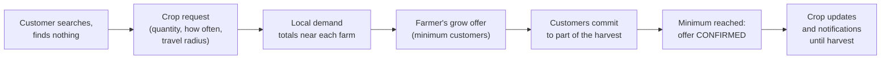
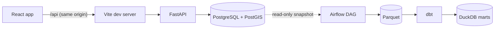
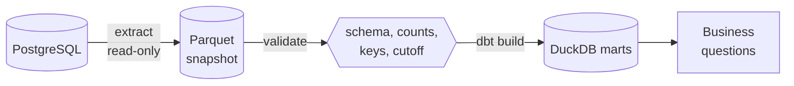

# Farm2Local

A location-aware agriculture marketplace that connects customers with nearby farms, and
lets customers ask local farmers to grow the crops they cannot find.

**Documentation:** [Architecture](docs/architecture.md) ·
[Database design](docs/database-design.md) · [API overview](docs/api-overview.md) ·
[Grow-On-Demand](docs/grow-on-demand.md) · [Data pipeline](docs/data-pipeline.md)

## Project Overview

Farm2Local is a full-stack web application with three parts:

- **A marketplace.** Farmers list fresh products and bookable farm experiences. Customers
  search by location and travel radius, reserve products for pickup and book places at
  pick-your-own days and farm tours.
- **Grow-On-Demand.** When a search finds nothing, customers can request the crop. Farmers
  see the combined local demand, offer to grow it, and the offer is confirmed once enough
  customers commit. Farmers then share the crop's progress until harvest.
- **An analytics pipeline.** A daily Airflow DAG turns the marketplace's activity into
  answers about demand and supply, in a warehouse kept apart from the application's
  database.

It runs entirely on a local machine with Docker Compose and needs no cloud account.

## Problem

Small farms and the people who live near them have trouble finding each other. Customers
do not know which nearby farm has eggs this week or when the strawberries are ready, and
general marketplaces are not organized around distance. Farmers, in turn, decide what to
plant months ahead with little idea of what local customers would actually buy, so demand
for crops nobody grows nearby goes unnoticed.

## Solution

Farm2Local organizes everything around where people are:

- Every farm has a location, and every search is a radius around the customer, answered by
  PostGIS inside the database.
- Stock is tracked per product with a full history, and reservations take stock under a
  database lock, so two customers can never both get the last units.
- A search that comes up empty is not a dead end: it leads straight to a request for that
  crop, which feeds the demand farmers see.
- Customers' locations stay private. Farmers see demand as totals for their own area,
  never as individual customers or coordinates.

## Grow-On-Demand



- Requests from customers whose travel radius reaches a farm are added together into
  demand that farmer can see: how many customers want a crop and how much per week.
- A farmer's grow offer names a quantity, an estimated price, planting and harvest dates and
  the number of customers it needs. When enough commit, it is confirmed automatically, under
  a row lock so simultaneous commitments are counted correctly.
- The farmer posts updates from planting to harvest; committed customers are notified in
  the app and can follow the crop's journey. Farmers can also poll nearby customers on what
  to grow next.

The full rules, including what farmers can and cannot see, are in
[docs/grow-on-demand.md](docs/grow-on-demand.md).

## Features

**For customers**

- Search products by location, radius, name, category and availability, sorted by
  distance, price or harvest date
- Reserve products for pickup and book farm experiences, then view or cancel reservations
- Request crops that no nearby farm sells, straight from an empty search
- Browse and join grow offers, follow a crop's journey, vote in crop polls
- In-app notifications with an unread count

**For farmers**

- A farm profile, products with stock levels and history, hidden or visible listings
- Farm events with capacity, and the reservations and bookings for them
- Local demand for crops near the farm, grow offers created from it, crop updates
- Crop polls with live vote counts

**Platform**

- Role-based access for customers and farmers, enforced by the API
- Loading, empty and error states throughout the interface
- Security hardening: login throttling, security headers, size limits, no internal details
  in errors, customer coordinates kept out of logs
- A daily, idempotent analytics pipeline with data quality tests

## Technology Stack

| Layer | Technology |
| ----- | ---------- |
| Frontend | React 19, TypeScript, Vite, Tailwind CSS, React Router |
| Backend | Python 3.12, FastAPI, SQLAlchemy 2, Pydantic 2, Alembic |
| Database | PostgreSQL 17 with PostGIS 3.5 |
| Authentication | Argon2id password hashes, HS256 JWT access tokens |
| Data pipeline | Apache Airflow 3, PyArrow (Parquet), dbt, DuckDB |
| Infrastructure | Docker Compose |
| Testing | Pytest, Vitest, React Testing Library, Playwright |

### Significant dependencies

| Dependency | Why it is used |
| ---------- | -------------- |
| `psycopg` 3 | PostgreSQL driver for SQLAlchemy and the pipeline's extract |
| `geoalchemy2` | PostGIS column types and spatial functions for SQLAlchemy |
| `pydantic-settings` | Typed configuration loaded from environment variables |
| `argon2-cffi` | Argon2id password hashing |
| `PyJWT` | Signing and verifying access tokens |
| `email-validator` | Email validation behind Pydantic's `EmailStr` |
| `tzdata` | Time zone database for platforms without one, such as Windows |
| `httpx2` | HTTP client for FastAPI's test client (dev only) |
| `@tailwindcss/vite` | Tailwind CSS integration for Vite |
| `jsdom` | Browser environment for component tests (dev only) |
| `@playwright/test` | Browser tests (dev only; pinned exactly because it drives browsers through a versioned protocol) |
| Apache Airflow | Schedules and runs the analytics DAG (the official image, unchanged) |
| `pyarrow` | Parquet files, and the filesystem layer that makes S3 a configuration change |
| `dbt-core`, `dbt-duckdb` | Transformations and data quality tests as versioned SQL |
| `duckdb` | The analytical database the marts live in, separate from PostgreSQL |

The frontend uses the browser's `fetch` and React context only; there is no HTTP client or
state-management library. The pipeline's libraries live in their own virtual environment
inside the Airflow image, so Airflow's pinned versions and the pipeline's never conflict.

## System Architecture



- **Frontend.** A single-page app with a dashboard for each role. It talks to the API
  through the dev server's proxy, so there is one origin and no cross-origin access.
- **Backend.** Routers handle HTTP, dependencies identify the caller and check role and
  ownership, services hold the business rules and transactions, and SQLAlchemy models
  carry the constraints that back them.
- **Database.** PostgreSQL with PostGIS answers every distance question and enforces the
  rules that matter most with constraints and row locks.
- **Analytics.** Kept out of the request path entirely: the application records events, and
  the pipeline analyzes a read-only snapshot in a different engine.

### Security

| Concern | Protection |
| ------- | ---------- |
| Passwords | Argon2id hashes, never returned; unknown emails and wrong passwords answered identically |
| Guessing | 5 failed logins per email or 50 per client in 15 minutes, then `429` with `Retry-After` |
| Access | Role and ownership checked by the API on every protected route; the frontend only mirrors it |
| Tokens | HS256 only, required expiry; the server refuses a short or example signing key |
| Errors | `422` responses never echo submitted values; `500` responses never describe the cause |
| Requests | Bodies over 1 MiB refused before parsing; security headers on every response; no CORS |
| Privacy | Customer coordinates removed from access logs, never shown to farmers, and only a coarse region reaches analytics |
| Secrets | Only in `.env`, which is ignored by version control; `.env.example` holds placeholders |

Details are in [docs/architecture.md](docs/architecture.md).

## Database

Sixteen tables cover accounts, farms, products and stock history, reservations, farm events,
the Grow-On-Demand workflow, polls, notifications and analytics events. The full
entity-relationship diagram is in [docs/database-design.md](docs/database-design.md).

Key decisions:

- **Constraints, not just code.** Rules two simultaneous requests could both pass, such as
  one farm per farmer, one open request per crop and one commitment per offer, are unique
  constraints. Ranges, statuses and enum values are named `CHECK` constraints.
- **Row locks** on products, events, reservations and grow offers make stock, capacity and
  confirmation correct under concurrent requests; tests prove it on two connections.
- **Exact money.** Prices are `NUMERIC(10, 2)` and travel through the API as strings.
- **Generated geography.** Locations are `geography(Point, 4326)` columns that PostgreSQL
  generates from latitude and longitude, with GiST indexes.
- **Migrations only.** Every schema change is an Alembic migration.

```bash
docker compose exec backend alembic upgrade head        # apply migrations
docker compose exec backend alembic current             # show the current revision
docker compose exec backend alembic revision --autogenerate -m "describe the change"
```

## Geographic Search

Customers search within 5, 10, 25, 50 or 100 miles of a point they type in or take from the
browser.

- `farms.location` is generated by PostgreSQL from the farm's coordinates and indexed with
  GiST.
- The radius filter is `ST_DWithin(location, point, meters)`, which uses that index, and
  distances come from `ST_Distance`, measured along the Earth's surface. No farm is loaded
  into Python to measure distance.
- Product results can be filtered by name, category and availability today, and sorted by
  distance, price or most recent harvest. Farm experiences, grow offers and polls use the
  same search.
- Local demand runs the other way: it finds the crop requests whose own travel radius
  reaches a farm, using each request's location rounded to about 0.7 miles.

A browser-provided location is rounded to about 100 meters before it is sent, and the
backend keeps search coordinates out of its access log.

## Testing

| Suite | Command | Covers |
| ----- | ------- | ------ |
| Backend | `docker compose exec backend pytest` | Every endpoint's rules, authorization, validation, constraints, concurrency, security hardening, event recording |
| Frontend | `cd frontend && npm test` | Pages and components against an in-memory fake of the API, the API client and helpers |
| Type check and build | `cd frontend && npm run build` | TypeScript across the app and the browser tests |
| Browser | `cd frontend && npm run test:e2e` | Complete farmer and customer flows in a real browser against a real backend |
| Pipeline | `docker compose --profile pipeline run --rm pipeline python -m pytest` | Storage, validation, the DAG as Airflow loads it, and an end-to-end pipeline run |

- **Backend.** The suite builds its own `<POSTGRES_DB>_test` database from the migrations
  and rolls every test back. The concurrency tests run two threads on two connections and
  fail if the row locks are removed.
- **Browser.** Playwright starts a separate `backend-e2e` container whose `<POSTGRES_DB>_e2e`
  database is recreated empty on every run, so tests never touch development data. One test
  walks every step of both flows: a farmer registers, creates a farm, a product, stock and an
  event; a customer searches with a chosen radius, reserves the product and the event, and
  requests a missing crop; the farmer sees the demand and makes a grow offer; the customer
  joins it, is notified, and follows the crop journey the farmer updates. On Windows the
  tests use the installed Microsoft Edge; elsewhere run `npx playwright install chromium`
  once or set `PLAYWRIGHT_CHANNEL`.
- **Pipeline.** The end-to-end test acts as farmers and customers through the API, runs the
  whole pipeline and checks every mart and business question against known answers. It
  needs the browser-test backend on a fresh database:

```bash
docker compose --profile e2e up -d --force-recreate --wait backend-e2e
docker compose --profile pipeline run --rm -e POSTGRES_DB=farm2local_e2e -e PIPELINE_TEST_API_URL=http://backend-e2e:8000 pipeline python -m pytest
```

## Local Setup

**Prerequisites:** Docker Desktop (or Docker Engine with the Compose plugin) and Node.js 22
or newer. Python does not need to be installed; the backend runs in a container. All
commands run from the repository root unless stated otherwise.

**1. Create the environment file.**

```bash
cp .env.example .env
```

`JWT_SECRET_KEY` signs every access token and the example value is public, so the backend
refuses to start until it is replaced. Generate one and paste it into `.env`:

```bash
docker compose run --rm --no-deps backend python -c "import secrets; print(secrets.token_urlsafe(48))"
```

**2. Start the database and backend, and apply the migrations.**

```bash
docker compose up -d --build --wait
docker compose exec backend alembic upgrade head
```

**3. Check the backend.**

```bash
curl http://localhost:8000/health
```

The answer is `{"status": "ok"}` once the API can query the database. Interactive API
documentation is at `http://localhost:8000/docs`.

**4. Start the frontend.**

```bash
cd frontend
npm install
npm run dev
```

Open `http://localhost:5173`, register as a farmer in one browser and as a customer in
another (or a private window), and try the flows above.

| Service | Address |
| ------- | ------- |
| Frontend | `http://localhost:5173` |
| Backend | `http://localhost:8000` |
| PostgreSQL | `localhost:5433` |
| Airflow (optional) | `http://localhost:8080` |

**Stopping.** `docker compose down` stops everything; data survives in the
`farm2local_postgres_data` volume. Add `-v` to start again from an empty database.

**Without Docker for the backend.** With Python 3.11 or newer and the database still in
Docker: `docker compose up -d --wait db`, then in `backend/` create a virtual environment,
`pip install -r requirements-dev.txt`, `alembic upgrade head` and
`uvicorn app.main:app --reload`. On Windows machines with Smart App Control, SQLAlchemy's
and psycopg's native extensions can be blocked; the container avoids this.

## Environment Variables

Set in `.env` (copied from `.env.example`):

| Variable | Purpose | Example |
| -------- | ------- | ------- |
| `POSTGRES_USER` | Database user | `farm2local` |
| `POSTGRES_PASSWORD` | Database password | `change_me_local_only` |
| `POSTGRES_DB` | Database name; test databases add `_test`, `_e2e` and `_airflow` | `farm2local` |
| `POSTGRES_HOST` | Database host when the backend runs outside Docker | `localhost` |
| `POSTGRES_PORT` | Host port published for the database | `5433` |
| `BACKEND_PORT` | Host port published for the backend | `8000` |
| `JWT_SECRET_KEY` | Signs access tokens; 32 characters or more, not the example | a random value |
| `ACCESS_TOKEN_EXPIRE_MINUTES` | Lifetime of an access token | `60` |
| `MARKETPLACE_TIMEZONE` | The time zone that decides what "today" is | `America/New_York` |
| `AIRFLOW_PORT` | Host port for the Airflow interface | `8080` |

Optional, set in the shell when needed:

| Variable | Purpose | Default |
| -------- | ------- | ------- |
| `API_PROXY_TARGET` | Where the frontend dev server sends `/api` | `http://localhost:8000` |
| `E2E_BACKEND_PORT` | Host port of the browser-test backend | `8001` |
| `E2E_KEEP_BACKEND` | Leave the browser-test backend running after the tests | unset |
| `PLAYWRIGHT_CHANNEL` | Browser for the browser tests | `msedge` on Windows |

Inside Docker the backend always reaches the database at `db:5432`; `POSTGRES_HOST` and
`POSTGRES_PORT` matter only when it runs on the host.

## API Documentation

The API has 48 operations under `/api`, plus `/health`. FastAPI serves interactive
documentation at `http://localhost:8000/docs`; [docs/api-overview.md](docs/api-overview.md)
lists every endpoint with who may call it and the rules it enforces.

| Area | Endpoints |
| ---- | --------- |
| Accounts | `POST /api/auth/register`, `POST /api/auth/login`, `GET /api/auth/me` |
| Farms | `/api/farms`, `/api/farms/me`, `/api/farms/{farm_id}` |
| Products | `/api/products`, `/api/products/mine`, `/api/products/{product_id}`, `.../inventory`, `/api/products/search` |
| Reservations | `/api/reservations`, `.../mine`, `.../farm`, `.../{reservation_id}/status` |
| Farm experiences | `/api/events`, `/api/events/mine`, `/api/events/search`, `/api/event-reservations` and its `mine`, `farm` and `status` routes |
| Grow-On-Demand | `/api/crop-requests`, `/api/demand`, `/api/grow-offers` and its search, detail, cancel, complete and updates routes, `/api/crop-commitments`, `/api/crop-polls`, `/api/crop-votes` |
| Notifications | `/api/notifications`, `.../unread-count`, `.../{notification_id}/read`, `.../read-all` |

Errors are JSON with a `detail` field and consistent status codes: `401` unauthenticated,
`403` not allowed, `404` not found, `409` conflict with current state, `422` invalid input,
`429` too many failed logins.

## Data Engineering Pipeline



- **Events.** The backend records ten kinds of activity in `application_events`, such as
  searches, searches with no result, reservations, crop requests and commitments. Actions
  are recorded in the same transaction as the change. Browsing events are anonymous, and no
  event holds personal details or exact locations.
- **One idempotent DAG.** `extract → validate → prepare_transformations` runs daily in
  Airflow. The extract reads one consistent read-only snapshot into Parquet, validation
  stops a bad snapshot before anything is built, and `dbt build` produces staging models and
  six marts in DuckDB. Re-running a date gives the same result.
- **Data quality.** 118 dbt tests on primary keys, required values, allowed values and
  relationships, plus unit tests for the trickiest calculations.
- **Answers.** Which crops are most searched, which find nothing, which regions have the most
  unmet demand, which farms turn stock over fastest, what share of grow offers reach their
  minimum, and which crops have strong demand but little supply.
- **Local first.** No cloud account is needed; raw storage is addressed by URI so S3 can
  replace the local directory later.

```bash
docker compose --profile pipeline up -d --build pipeline      # Airflow at localhost:8080
docker compose --profile pipeline run --rm pipeline python airflow/start_airflow.py dags test farm2local_analytics 2026-10-15
docker compose --profile pipeline run --rm pipeline python -m analytics.questions
```

Airflow's user is `admin`; its generated password is in
`/opt/airflow/simple_auth_manager_passwords.json.generated` inside the container. Everything
else is in [docs/data-pipeline.md](docs/data-pipeline.md).

## Project Structure

```
farm2local/
├── backend/
│   ├── alembic/            Migration environment and versions
│   ├── app/
│   │   ├── main.py         FastAPI application: middleware, error handlers, routers
│   │   ├── config.py       Settings loaded from the environment
│   │   ├── database.py     Engine, session factory and session dependency
│   │   ├── errors.py       Validation and unexpected-error responses
│   │   ├── log_redaction.py  Keeps query strings out of the access log
│   │   ├── dependencies/   Current user, role and ownership checks
│   │   ├── middleware/     Security headers and request size limit
│   │   ├── models/         SQLAlchemy models and constraints
│   │   ├── routers/        API routes
│   │   ├── schemas/        Pydantic request and response models
│   │   └── services/       Business rules: search, stock, reservations, Grow-On-Demand,
│   │                       notifications, login throttling, application events
│   ├── scripts/            Resets the database used by the browser tests
│   ├── tests/
│   └── Dockerfile
├── frontend/
│   ├── e2e/                Playwright browser tests
│   └── src/
│       ├── api/            Typed calls to the backend
│       ├── auth/           Session state and route guards
│       ├── components/     Forms, cards and shared fields
│       ├── data/           Reference data: US states, product, event and crop options
│       ├── lib/            Formatting, input parsing, data loading helpers
│       ├── pages/          Customer and farmer dashboards, notifications, crop journey
│       └── test/           Test setup and the fake API
├── data-pipeline/
│   ├── ingestion/          Extract to Parquet, raw storage, snapshot validation
│   ├── airflow/            The DAG and the script that starts Airflow
│   ├── dbt/                Staging, intermediate and mart models with their tests
│   ├── analytics/          Queries answering the business questions
│   ├── data/               Raw snapshots and the DuckDB warehouse (generated)
│   ├── tests/
│   └── Dockerfile
├── docs/                   Architecture, database, API, Grow-On-Demand and pipeline guides
├── docker-compose.yml
├── .env.example
└── README.md
```

## Future Improvements

- **Deployment.** Serve the production build behind HTTPS with a Content-Security-Policy and
  HSTS, run the API with several workers, and add continuous integration once the
  repository is published.
- **Sessions.** Move the access token to an `HttpOnly` cookie with refresh tokens, so script
  in the page cannot read it.
- **Shared rate limiting.** Keep login throttling in a shared store such as Redis so it
  works across several backend processes and behind a proxy.
- **Addresses instead of coordinates.** Geocode farm addresses and show results on a map;
  coordinates are typed in by hand today.
- **Notifications outside the app.** Optional email for confirmations and harvests.
- **Photos.** Upload crop-update photos to object storage instead of linking to them.
- **Richer analytics.** Record prices at reservation time, match crop names across singular
  and plural forms, extract events incrementally, and give the pipeline its own read-only
  database role and S3 storage.
- **Administration.** Tools for the existing `ADMIN` role to moderate listings and accounts.
