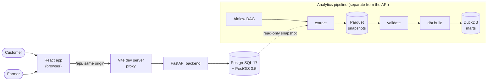
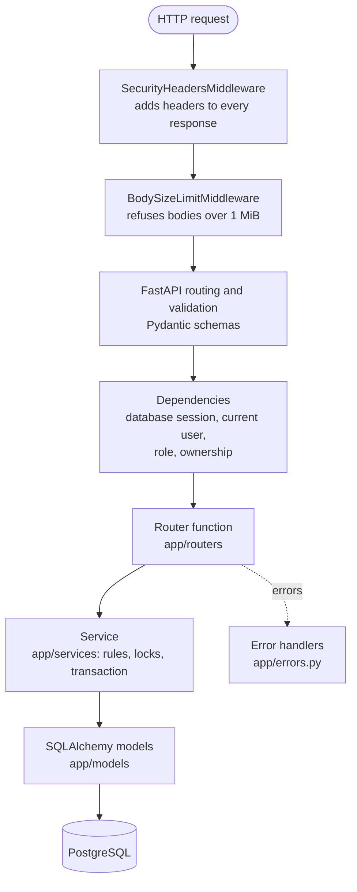
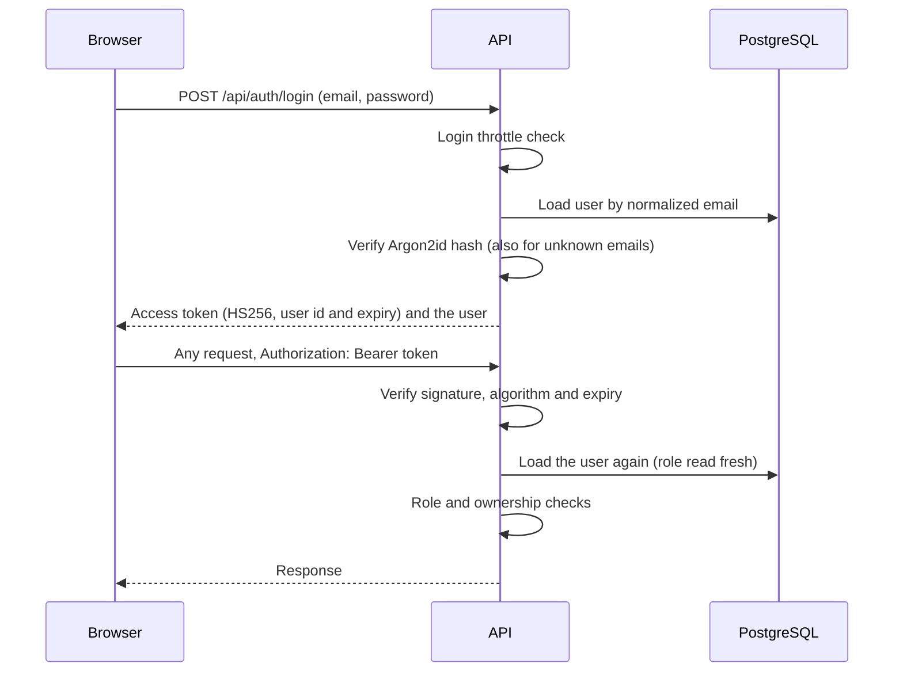

# Architecture

Farm2Local is a React single-page application backed by a FastAPI service and a
PostgreSQL/PostGIS database, with a separate analytics pipeline. Everything runs locally
under Docker Compose; the frontend runs with Vite on the host.

## System context

The browser only ever talks to one origin. The dev server forwards `/api` to the backend,
so the API needs no cross-origin access and allows none. The analytics pipeline reads the
database in read-only transactions and writes to its own files; nothing in the API reads
analytics.

## Containers

| Compose service | Profile | Runs | Port |
| --------------- | ------- | ---- | ---- |
| `db` | default | PostgreSQL 17 with PostGIS 3.5, data in the `postgres_data` volume | `127.0.0.1:5433` |
| `backend` | default | FastAPI with Uvicorn, source mounted for auto-reload | `127.0.0.1:8000` |
| `backend-e2e` | `e2e` | The same backend on an empty `_e2e` database, for browser and pipeline tests | `127.0.0.1:8001` |
| `pipeline` | `pipeline` | Airflow 3 with the DAG, the ingestion code and dbt | `127.0.0.1:8080` |

Every published port is bound to the loopback address, so nothing is reachable from the
network. The frontend dev server runs on the host at `localhost:5173`.

## Backend

| Layer | Responsibility |
| ----- | -------------- |
| `app/main.py` | Builds the application: middleware, error handlers, routers |
| `app/routers` | HTTP only: parse the request, call a service, map domain errors to status codes |
| `app/dependencies` | Who is calling: the token's user, the required role, the resource they own |
| `app/schemas` | Pydantic request and response models: what may be sent, what is returned |
| `app/services` | Business rules and transactions: stock, capacity, statuses, demand, notifications, events |
| `app/models` | SQLAlchemy tables and the constraints that back the rules |
| `app/errors.py` | `422` without the submitted value, and a plain `500` for anything unexpected |
| `app/config.py` | Typed settings from the environment; refuses an unsafe signing key |

Services raise domain exceptions such as `InsufficientStockError`; routers translate them
into HTTP responses. A request body field that is not in a schema, such as an `owner_id`
or a `status` on creation, is ignored, so ownership and state always come from the server.

### Authentication

The frontend stores the token in `localStorage` so a session survives a reload, checks it
against `/api/auth/me` on startup, and ends the session on any `401` from a request that
carried it.

## Frontend

| Part | Role |
| ---- | ---- |
| `src/routes.tsx` | One route table; customer and farmer dashboards are guarded by role |
| `src/auth` | `AuthProvider` (React context) holds the session; route guards redirect by role |
| `src/api` | One typed module per area over a single `fetch` wrapper that turns failures into readable messages |
| `src/lib` | Formatting, coordinate parsing, the remembered search location, `useAsyncData` for loading states |
| `src/components` | Forms, cards and shared fields; every list has loading, empty and error states |
| `src/pages` | The customer and farmer dashboard pages, notifications and the crop journey |

There is no state-management library: server data is loaded per page, and only the session
is application-wide. Empty states lead somewhere useful; an empty product search, for
example, offers to request the crop from local farmers.

## Geographic search

Product, event, grow-offer and poll searches all find things on farms within a radius of a
point, and all do it inside PostgreSQL:

- `farms.location` is a `geography(Point, 4326)` column that PostgreSQL generates from the
  farm's latitude and longitude, with a GiST index.
- The radius filter is `ST_DWithin(farms.location, search_point, radius_in_meters)`, which
  can use the index. Distances come from `ST_Distance` on the same column, measured along
  the Earth's surface and converted to miles.
- No farm is loaded into Python to measure distance; only rows inside the radius are
  returned, already sorted.
- The local-demand query runs the other way: it finds the crop requests whose own travel
  radius reaches the farm, using each request's rounded location.

Search coordinates are query parameters because the search is a `GET`, so the backend
removes query strings from its access log. The browser rounds a "use my location" position
to three decimal places, about 100 meters, before sending it.

## Data integrity

- Rules two simultaneous requests could both pass are backed by unique constraints.
- Read-then-write operations hold a row lock for their transaction: reserving stock,
  booking event places, committing to an offer, posting crop updates.
- Side effects are saved with the change that causes them: an inventory history row with
  every stock change, notifications with the event they report, an analytics event with
  the action it describes.

Details are in [database-design.md](database-design.md).

## Analytics separation

The application only records events. Everything analytical happens after the fact, from a
consistent read-only snapshot, in a different database engine. A slow analytical query can
never slow the marketplace down. See [data-pipeline.md](data-pipeline.md).

## Testing

| Level | Tool | Runs against |
| ----- | ---- | ------------ |
| Backend | Pytest | A `_test` database built from the real migrations; each test rolled back |
| Concurrency | Pytest, two threads on two connections | The same database, committing for real |
| Frontend | Vitest, React Testing Library | jsdom with an in-memory fake of the API |
| Browser | Playwright (Microsoft Edge) | The real frontend and the `backend-e2e` container |
| Pipeline | Pytest, dbt tests, `airflow dags test` | Temporary storage and the `_e2e` database |

## Security

The main protections, and where they live:

| Concern | Where |
| ------- | ----- |
| Passwords hashed with Argon2id, never returned | `app/services/security.py` |
| Login throttling per email and per client | `app/services/login_throttle.py` |
| Role and ownership checks on every protected route | `app/dependencies` |
| No values echoed in validation errors; no internals in `500`s | `app/errors.py` |
| Security headers; 1 MiB body limit | `app/middleware` |
| Customer coordinates kept out of the access log | `app/log_redaction.py` |
| Customer locations never shown to farmers; demand only as totals | `app/services/crop_requests.py` |
| Signing key must be long and not the example value | `app/config.py` |
| No secrets in the repository; `.env` is ignored | `.gitignore`, `.env.example` |
