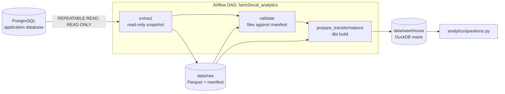
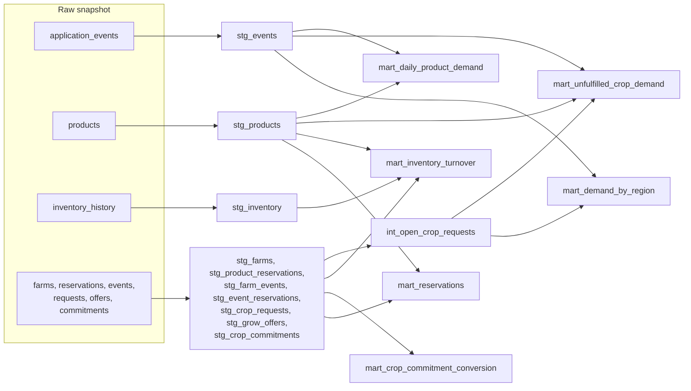

# Data Pipeline

PostgreSQL stays the transactional source of truth. Analytics happen somewhere else: a
daily Airflow DAG copies a consistent snapshot of the data to Parquet files, checks it, and
builds analytical tables in a separate DuckDB database with dbt. Nothing in the API reads
analytics, and the pipeline never writes to the application's database.



| Directory | Contents |
| --------- | -------- |
| `data-pipeline/ingestion` | The extract, the dataset definitions, raw storage and snapshot validation |
| `data-pipeline/airflow` | The DAG and `start_airflow.py`, which prepares Airflow's metadata database |
| `data-pipeline/dbt` | Staging, intermediate and mart models with their tests |
| `data-pipeline/analytics` | Queries that answer the business questions |
| `data-pipeline/data/raw` | Raw snapshots (generated, not committed) |
| `data-pipeline/data/warehouse` | The DuckDB warehouse (generated, not committed) |

## Application events

The backend records what happens in `application_events`: `id`, `event_type`, nullable
`user_id`, `farm_id` and `product_id`, a JSON `metadata` object and `created_at`.

| Event | Recorded when | Metadata |
| ----- | ------------- | -------- |
| `SEARCH_PERFORMED` | A product search runs | Normalized search term, category, radius, sort, availability filter, result count, region |
| `NO_SEARCH_RESULT` | A product search finds nothing (in addition to the above) | The same |
| `PRODUCT_VIEWED` | A listing appears in search results | Search id, position in the results |
| `FARM_VIEWED` | A farm appears in search results, or its public profile is read | Search id, or the source |
| `CROP_REQUESTED` | A customer requests a crop | Request id, crop, quantity, unit, frequency, radius |
| `GROW_OFFER_CREATED` | A farmer offers to grow a crop | Offer id, crop, quantity, unit, minimum customers |
| `CROP_COMMITTED` | A customer joins a grow offer | Commitment and offer ids, crop, quantity, whether it confirmed the offer |
| `RESERVATION_CREATED` | A product is reserved | Reservation id, quantity, pickup date |
| `INVENTORY_UPDATED` | A farmer changes a product's stock | Previous and new quantity |
| `FARM_EVENT_BOOKED` | A customer books a farm experience | Booking and event ids, event type, party size |

There is no separate product or farm page; search results are where customers see
listings, so a listing shown in results counts as a view.

- **Actions are recorded atomically.** The event for a reservation, booking, request, offer,
  commitment or stock change is written in the same transaction as the action. It exists if
  and only if the action was saved; a refused or rolled-back action records nothing.
- **Browsing never fails because of analytics.** Search and view events are committed on
  their own. If that fails, the error is logged and the search is answered normally.
- **No unnecessary personal data.** Browsing events carry no user, even for a signed-in
  customer. No event holds a name, email, note or exact location: a search keeps only its
  region, the latitude and longitude rounded to one decimal place (a cell about 7 miles
  across). The database requires `metadata` to be a JSON object and `event_type` one of
  the ten types.

## The DAG

One DAG, `farm2local_analytics`, with three tasks in a line. Each run works on one snapshot
date and overwrites that date's output, so a run can be retried or repeated and leaves the
same result.

| Task | What it does |
| ---- | ------------ |
| `extract` | Reads every dataset in one `REPEATABLE READ`, `READ ONLY` transaction, so all tables come from the same moment and the pipeline cannot write. Keeps rows created before the end of the snapshot date (UTC), streams them in batches to `raw/<dataset>/snapshot_date=<date>/<dataset>.parquet`, then writes a manifest with row counts. Files appear only once complete. |
| `validate` | Checks every file against the manifest: present and readable, exactly the agreed columns and types, the same row count, a unique non-null primary key, nothing after the cutoff. Any problem fails the run before anything is transformed. |
| `prepare_transformations` | `dbt build` for the snapshot: staging, intermediate and mart models, their data tests and unit tests. A failing test stops everything downstream of it. |

- **Schedule.** Daily, with data intervals: the run that starts at midnight UTC on 16
  October has 15 October as its logical date, so it snapshots a complete day whose cutoff
  has already passed. Airflow 3's default `@daily` would instead stamp it with the day just
  beginning; the DAG asks for `CronDataIntervalTimetable` explicitly to avoid that.
- **No catch-up.** Each run rebuilds the marts from a complete snapshot, so missed days need
  no backfill.
- **One run at a time.** Runs share the raw files and the warehouse.
- **One retry** after five minutes, for transient failures such as a restarting database.

Airflow only orchestrates. Every task runs a command in the pipeline's own virtual
environment, so Airflow's pinned dependencies and the pipeline's are independent. Airflow
keeps its run history in a separate `<POSTGRES_DB>_airflow` database.

## What leaves the database

The extract takes only the columns analytics needs:

| Dataset | Columns extracted | Left in PostgreSQL |
| ------- | ----------------- | ------------------ |
| `application_events` | All | |
| `farms` | Id, farmer id, name, city, state, region, fulfilment flags | Street address, ZIP code, phone, description, exact coordinates |
| `products` | All but the description | Description |
| `inventory_history` | All | |
| `product_reservations` | All but the pickup time | Pickup time |
| `farm_events` | Id, farm, type, date, price, capacity | Title, description, times |
| `event_reservations` | All | |
| `crop_requests` | All but location and notes, plus the region | Exact coordinates, notes |
| `grow_offers` | All | |
| `crop_commitments` | All | |

User accounts are not extracted at all; users appear only as ids. A region is latitude and
longitude rounded to one decimal place, on the same grid for farms, requests and searches.

**Storage.** Raw files go through a filesystem chosen by `RAW_DATA_URI`. It is a local
directory today. Setting it to an `s3://bucket/prefix` URI writes the same layout to S3 with
no code change, given AWS credentials in the environment and DuckDB's `httpfs` extension in
`dbt/profiles.yml` so dbt can read it back. No AWS account is needed to run locally.

## dbt models



| Model | Grain | Purpose |
| ----- | ----- | ------- |
| `stg_events` | Event | Application events with their metadata unpacked into typed columns |
| `stg_products`, `stg_inventory` | Product, stock change | Listings, and every change to their stock |
| Seven other `stg_` models | One row per source row | Renamed, typed copies of the other datasets |
| `int_open_crop_requests` | Open request | Marks requests already covered by a grow offer the customer joined, the same rule as the local-demand endpoint |
| `mart_daily_product_demand` | Day and product | Views in search results, reservations, units reserved, reservations per view |
| `mart_unfulfilled_crop_demand` | Crop | Searches, searches with no result, unmet requests, customers waiting, listings available, active grow offers, demand per listing |
| `mart_demand_by_region` | Region cell | The same demand signals and the farms and listings in each region |
| `mart_inventory_turnover` | Farm | Average stock value rebuilt day by day from the inventory history, value sold, turnover and days of inventory |
| `mart_crop_commitment_conversion` | Grow offer | Customers committed, whether and how fast the minimum was reached, how many committers had asked for the crop first |
| `mart_reservations` | Reservation | Product reservations and farm experience bookings together, with lead time and estimated value |

Days in the marts are calendar days in `MARKETPLACE_TIMEZONE`, like the application's.
Search terms use the crop-name spelling rule (each word capitalized), so a search for
"okra" and a request for "Okra" count as the same crop.

## Data quality

`dbt build` runs every test before building anything downstream of it:

| Rule | Tests |
| ---- | ----- |
| Primary keys | `unique` and `not_null` on every staging, intermediate and mart key; `unique_combination_of_columns` for composite keys |
| Required values | `not_null` on every column the application requires |
| Allowed values | `accepted_values` for event types, statuses, categories, units, frequencies, seasons and farm event types |
| Relationships | Every reference must point at a row in the snapshot, including ids inside event metadata |
| Calculations | dbt unit tests for inventory turnover and commitment conversion against hand-worked examples |

There are 118 data tests and 2 unit tests. Raw files are also checked by the `validate`
task before dbt runs, as described above.

## Questions the pipeline answers

`python -m analytics.questions` runs these against the marts:

| Question | Answered from |
| -------- | ------------- |
| Which crops are most searched? | `mart_unfulfilled_crop_demand.searches` |
| Which crops frequently return no results? | `no_result_searches` and `no_result_rate` |
| Which regions show the highest unmet demand? | `mart_demand_by_region.unmet_demand_signals`: searches with no result plus requests no grow offer meets |
| Which farms have the fastest inventory turnover? | `mart_inventory_turnover.days_of_inventory`, fewest first |
| What percentage of Grow Offers reach commitment? | Share of `mart_crop_commitment_conversion` rows with `reached_minimum` |
| What crops show strong demand but low supply? | `demand_per_listing`: searches and customers waiting per available listing |

Limits of these figures: a search with no result can come from a category filter or a small
radius, not only a missing crop; crops match listings by name, so "Tomato" and "Tomatoes"
differ; values use each product's current price, since past prices are not recorded; and a
region cell is a grid square, not a travel area.

## Running it

The pipeline runs in the `pipeline` service, built on the official Airflow 3 image, in the
Compose `pipeline` profile. The application stack must be running and migrated.

```bash
# Airflow with its web interface at http://localhost:8080
docker compose --profile pipeline up -d --build pipeline

# The generated password for the user "admin"
docker compose --profile pipeline exec pipeline cat /opt/airflow/simple_auth_manager_passwords.json.generated

# One complete run for a date, in the terminal, without the scheduler
docker compose --profile pipeline run --rm pipeline python airflow/start_airflow.py dags test farm2local_analytics 2026-10-15

# The answers to the business questions
docker compose --profile pipeline run --rm pipeline python -m analytics.questions
```

New DAGs start paused; unpause `farm2local_analytics` in the interface to schedule it. The
pipeline container receives only the database settings and time zone, not the backend's
signing key.

## Tests

```bash
docker compose --profile pipeline run --rm pipeline python -m pytest
```

| Tests | Cover |
| ----- | ----- |
| `test_storage.py` | Partition layout, file and plain-path URIs, atomic replacement, nothing left half-written |
| `test_validate.py` | Every validation rule, each with a snapshot that breaks it |
| `test_snapshots.py` | The cutoff, the date argument, conversion of database rows to Arrow types |
| `test_dag.py` | The DAG loaded by Airflow itself: no import errors, task order, the logical date of the midnight run, rendered commands |
| `test_pipeline_end_to_end.py` | The whole pipeline on real activity (below) |

The end-to-end test acts as farmers and customers through the browser-test backend's API,
so every event is recorded by the application's own code. It then extracts, validates, runs
`dbt build` and checks each mart and every business question against what it did. It also
checks that no personal detail or exact customer location reaches a raw file, that
extracting the same date twice gives identical files, and that the extract's transaction
cannot write. It needs that backend on a fresh database:

```bash
docker compose --profile e2e up -d --force-recreate --wait backend-e2e
docker compose --profile pipeline run --rm -e POSTGRES_DB=farm2local_e2e -e PIPELINE_TEST_API_URL=http://backend-e2e:8000 pipeline python -m pytest
```

Without `PIPELINE_TEST_API_URL` the end-to-end test is skipped.

## Limitations

- Every snapshot is a full copy of each table. That suits this scale; at real volume,
  events should be extracted incrementally by date.
- Product search writes about one event row per listing shown, and searches are not rate
  limited.
- The pipeline connects with the application's database user. Its transactions are read-only,
  but a dedicated read-only role would be the production arrangement.
- Snapshots cut off at midnight UTC while marts report marketplace days, so the first and
  last day of a snapshot can be partial.
- Airflow runs in its single-container standalone mode, which is meant for development.
