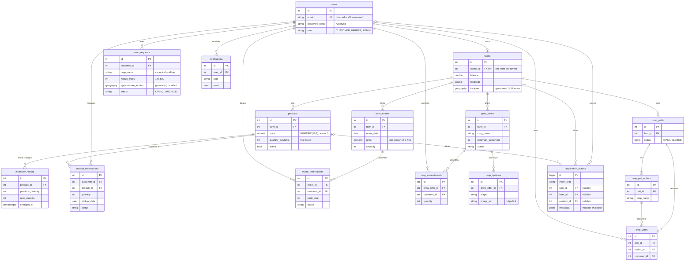

# Database Design

PostgreSQL 17 with PostGIS 3.5 is the single source of truth for the marketplace. The
schema is defined by SQLAlchemy models in `backend/app/models` and created only through
Alembic migrations in `backend/alembic/versions`.

## Entity relationships

## Tables

| Table | Holds | Integrity rules in the database |
| ----- | ----- | ------------------------------- |
| `users` | Accounts and roles | Unique email; email must already be trimmed and lowercased; role limited to three values |
| `farms` | One profile per farmer | Unique `owner_id`; latitude and longitude ranges |
| `products` | Listings with stock | Price above 0; stock 0 or more; availability window ordered; category and unit limited |
| `inventory_history` | Every stock change | Quantities not negative; previous and new must differ |
| `product_reservations` | Pickup reservations | Quantity above 0; status limited |
| `farm_events` | Bookable farm experiences | Ends after it starts; price not negative; capacity above 0; type limited |
| `event_reservations` | Bookings for events | Party size above 0; status limited |
| `crop_requests` | Customers' requests for crops | Quantity above 0; radius 1 to 500; coordinate ranges; one open request per customer and crop (partial unique index) |
| `grow_offers` | Farmers' offers to grow a crop | Quantity, price and minimum above 0; harvest not before planting; status limited |
| `crop_commitments` | Customers joining offers | Quantity above 0; one per customer per offer |
| `crop_updates` | The crop journey | Stage limited |
| `crop_polls`, `crop_poll_options`, `crop_votes` | Polls on what to grow | Option names unique per poll; one vote per customer per poll; a vote's option must belong to its poll (composite foreign key) |
| `notifications` | In-app messages | Type limited |
| `application_events` | Activity recorded for analytics | Type limited; metadata must be a JSON object; links cleared when a user, farm or product is deleted (`ON DELETE SET NULL`) |

All 16 tables have an integer primary key (`bigint` for `application_events`). Every table
except `crop_poll_options`, whose rows only exist as part of a poll, has a `created_at`
timestamp set by the database clock.

## Design decisions

**Rules that matter live in the database.** Uniqueness that two simultaneous requests could
otherwise both pass (one farm per farmer, one open request per crop, one commitment per
offer, one vote per poll, unique emails) is a constraint or unique index, not only an
application check. The application checks first to give a clear error; the database is the
final guard.

**Enums are text with a named CHECK.** Statuses, roles, categories and units are stored as
`VARCHAR` with a `CHECK (column IN (...))` instead of native PostgreSQL enum types, so
adding a value is an ordinary constraint change rather than an `ALTER TYPE`.

**Money is exact.** Prices are `NUMERIC(10, 2)`. No monetary value is ever a float, in the
database or in the API.

**Locations are generated, not maintained.** `farms.location` and
`crop_requests.approximate_location` are stored generated `geography(Point, 4326)`
columns, computed by PostgreSQL from the latitude and longitude. They cannot disagree with
the coordinates, and both have GiST indexes for radius queries. The request point is
rounded to two decimal places before it is generated, which is how customers' exact
locations are kept out of every distance comparison a farmer can trigger.

**Constraint names are deterministic.** A naming convention on the SQLAlchemy metadata
(`ck_<table>_<name>`, `fk_<table>_<column>_<referred table>`, `uq_...`, `ix_...`,
`pk_<table>`) gives every constraint a stable name that migrations can refer to.

**Stock has an audit trail.** `products.quantity_available` is changed in exactly one
function, which adds an `inventory_history` row in the same transaction. The analytics
pipeline rebuilds daily stock levels from that history.

## Concurrency

Operations that read a value and then change it based on what they read hold a row lock
(`SELECT ... FOR UPDATE`) for the whole transaction:

| Operation | Row locked | What it prevents |
| --------- | ---------- | ---------------- |
| Reserving a product, changing its stock | The product | Two customers both getting the last units |
| Changing a product reservation's status | The reservation, then the product | Stock returned twice by two cancellations |
| Booking a farm event | The event | Capacity exceeded by simultaneous bookings |
| Committing to a grow offer | The offer | An offer that reached its minimum left open |
| Posting a crop update, cancelling or completing an offer | The offer | Status and journey falling out of step |

These are tested on two real database connections in
`backend/tests/test_reservation_concurrency.py` and
`backend/tests/test_grow_offer_concurrency.py`, which fail when the locks are removed.

## Migrations

| Revision | Change |
| -------- | ------ |
| `77db061d9ced` | Enable the PostGIS extension |
| `c7fcbb4de082` | `users` |
| `710bd5f7de91` | `farms` |
| `f85ecd722ec8` | `products`, `inventory_history` and the farm location column |
| `44a7b480e20e` | Reservations and farm events |
| `bc33c01abf89` | Grow-On-Demand: crop requests, grow offers, commitments |
| `84cbcd5aa219` | Crop polls, crop updates and notifications |
| `e1a7c4b9d2f3` | `application_events` |

Every schema change is a migration; the database is never dropped and recreated as an
upgrade strategy, and development data survives upgrades. `alembic check` confirms the
models and the migrations agree.

## Databases on the server

| Database | Used by |
| -------- | ------- |
| `<POSTGRES_DB>` | The application |
| `<POSTGRES_DB>_test` | The backend test suite, rebuilt from the migrations on every run |
| `<POSTGRES_DB>_e2e` | The browser tests and the pipeline's end-to-end test, recreated empty each time the e2e backend starts |
| `<POSTGRES_DB>_airflow` | Airflow's own records of DAG runs |

The analytics warehouse is not in PostgreSQL at all: it is a DuckDB file built by the
data pipeline. See [data-pipeline.md](data-pipeline.md).
