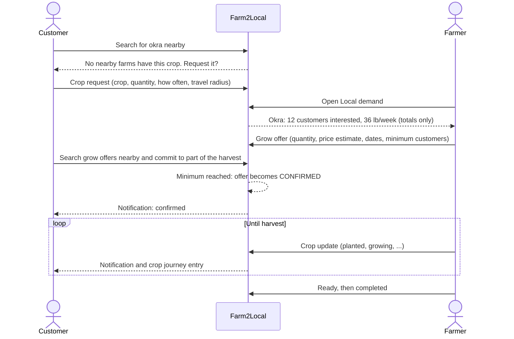
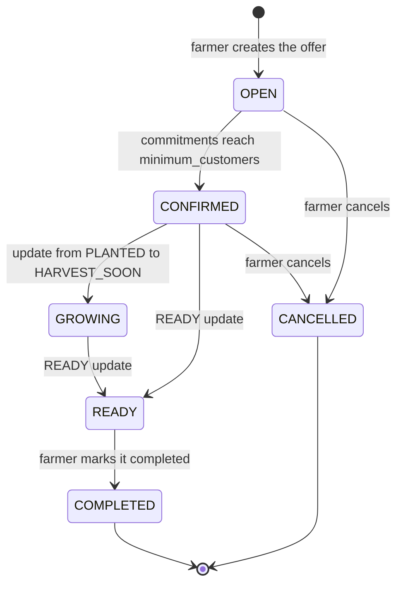

# Grow-On-Demand

Most local marketplaces only sell what farms already grow. Grow-On-Demand runs the other
way: customers say what they cannot find, farmers see how much local demand there is, and
a crop is planted once enough customers have committed to buy it.

## The loop



The link from search to request is built into the interface: an empty product search
offers "Request this crop", which opens the request form with the search term filled in.

## Crop requests

A customer asks for a crop with a `crop_name`, `quantity`, `unit`, `frequency` (`ONE_TIME`,
`WEEKLY` or `MONTHLY`), their `latitude` and `longitude`, the `radius_miles` they would
travel, and optionally a `preferred_season` and `notes`.

- **One spelling per crop.** Names are trimmed and each word capitalized, so `"sweet  CORN"`
  is stored as `"Sweet Corn"`. Requests, offers, polls and analytics all match on this form.
  Singular and plural are still different names.
- **One open request per customer per crop.** A partial unique index on
  `(customer_id, crop_name) WHERE status = 'OPEN'` enforces it, so demand cannot be
  inflated by asking twice; the API answers a repeat with `409`.
- **Customers only.** Farmers and administrators get `403`. Another customer's request is
  reported as `404` on cancel, so the endpoint does not confirm which ids exist.

## Local demand

`GET /api/demand` gives a farmer one row per crop and unit near their own farm:

```json
{
  "crop_name": "Okra",
  "unit": "LB",
  "customers_interested": 12,
  "estimated_weekly_quantity": 36.0,
  "one_time_quantity": 0
}
```

- **Which requests count.** An open request counts when the farm is within the distance
  its customer said they would travel. PostGIS compares them with `ST_DWithin`, using each
  request's own `radius_miles`.
- **Weekly estimate.** Weekly requests count in full and monthly ones at 12/52 of their
  quantity. One-time requests are totalled separately.
- **Demand already being met is left out.** A request stops counting once its customer
  has joined an active grow offer for the same crop (`OPEN`, `CONFIRMED`, `GROWING` or
  `READY`), and counts again if that offer is cancelled. This is worked out from the
  commitments on every read, never stored, so it cannot fall out of step.

### What farmers can and cannot see

Customers' locations are private, and the demand endpoint is built so it cannot reveal them:

- The response has only the five fields above: no coordinates, customer ids, names, notes
  or per-request rows.
- A farmer can ask only about their own farm, never about an arbitrary point.
- Matching uses a second point PostgreSQL generates for each request, the coordinates
  rounded to two decimal places: a cell about 0.7 miles across. A farmer who keeps moving
  their farm to see where a request appears could at best find that cell, not an address.

A single request still shows as "1 customer interested". Hiding small counts would protect
a lone requester further, but it would also hide exactly the early demand the feature
exists to surface.

## Grow offers

An offer has a `crop_name`, `expected_quantity`, `unit`, `estimated_price` per unit,
`planting_date`, `expected_harvest_date` and `minimum_customers`. Every offer starts `OPEN`.



Each offer is returned with `committed_customers` and `committed_quantity`, shown as
"12 / 20 customers committed". Farmers see these totals, never who committed. Offer search
returns `OPEN` and `CONFIRMED` offers whose harvest date has not passed, soonest harvest
first.

## Commitments and confirmation

- **One commitment per customer per offer.** A second is `409`, backed by a unique
  constraint on `(grow_offer_id, customer_id)`.
- **No more than the harvest.** Asking for more than remains is `409` with the amount left.
- **Only `OPEN` and `CONFIRMED` offers** accept commitments.
- **Automatic confirmation.** When the number of committed customers reaches
  `minimum_customers`, the offer moves from `OPEN` to `CONFIRMED`. The threshold counts
  customers, not quantity.
- **No payment.** A commitment is a promise to buy, not a purchase.

Confirmation is safe under concurrency. Committing locks the offer row (`SELECT ... FOR
UPDATE`) before anything is counted, so commitments to one offer are processed one at a
time and the commitment that reaches the threshold is the one that confirms it. The
commitment, the status change and the confirmation notifications are saved in one
transaction. Without the lock, two customers committing at the same moment could each
count only themselves and leave an offer that had met its threshold still open;
`backend/tests/test_grow_offer_concurrency.py` reproduces that race on two connections.

## Crop journey

The farmer keeps committed customers informed with crop updates. Each has a `stage`, a
`message` and an optional `image_url`. Stages in growing order: `PLANNED`, `PLANTED`,
`GERMINATED`, `GROWING`, `FLOWERING`, `HARVEST_SOON`, `READY`.

| Offer status | Update stage | Offer becomes |
| ------------ | ------------ | ------------- |
| `OPEN` | `PLANNED` | stays `OPEN` |
| `CONFIRMED` | `PLANNED` | stays `CONFIRMED` |
| `CONFIRMED` | `PLANTED` to `HARVEST_SOON` | `GROWING` |
| `CONFIRMED` or `GROWING` | `READY` | `READY` |
| `READY` | marked completed by the farmer | `COMPLETED` |

- Only the farm's owner can post; anyone else, including committed customers, gets `403`.
- An open offer can only be planned: until enough customers commit, the farmer has not
  agreed to grow the crop, so later stages are `409`.
- Stages never go backwards (`409`); posting the same stage again is allowed.
- `COMPLETED` and `CANCELLED` offers take no updates.
- Photos are `https` links, shown as a "View photo" link rather than an embedded image. An
  image that loaded automatically would let whoever hosts it see the network address of
  every customer who opens the page.

## Notifications

Notifications are in-app only. Customers committed to an offer are told when:

| Event | Type |
| ----- | ---- |
| The offer reaches its minimum and is confirmed | `GROW_OFFER_CONFIRMED` |
| The farmer posts a crop update | `CROP_UPDATE_POSTED` |
| A `READY` update makes the crop ready | `CROP_READY` |
| The farmer cancels the offer | `GROW_OFFER_CANCELLED` |

A notification is written in the same transaction as the event it reports, so there is
never one without the other. Confirmation is announced once, to everyone committed at that
moment, including the customer whose commitment reached the minimum. The header shows the
unread count and reads it again on every page navigation.

## Crop polls

A farmer deciding what to plant can ask nearby customers. A poll has a `question` (by
default "What should I grow next?") and two to eight crop `options` in the canonical
spelling.

- One vote per customer per poll, enforced by a unique constraint on `(poll_id, customer_id)`.
- A vote's option must belong to its poll. The API refuses a mismatch with `422`, and a
  composite foreign key from `(poll_id, option_id)` to the options makes the database
  refuse it as well.
- Closed polls take no votes. Farmers see how many votes each option has, never who cast them.

## In the analytics

Crop requests, grow offers and commitments are recorded as application events, and the
data pipeline turns them into `mart_unfulfilled_crop_demand`, `mart_demand_by_region` and
`mart_crop_commitment_conversion`. See [data-pipeline.md](data-pipeline.md).
